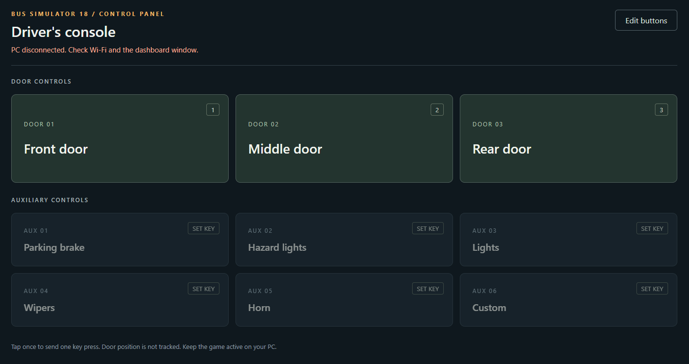

# Bus Dashboard — Wireless Driver's Console for Bus Simulator 18


-2EA44F?style=flat-square)


Turn an old tablet (such as a **Microsoft Surface RT**) or smartphone into a wireless touchscreen button box for **Bus Simulator 18** over your home Wi-Fi.

Built with zero external dependencies: the host runs a lightweight PowerShell HTTP server with native Windows `SendInput` scan-code simulation, and the tablet runs a pure ES5 HTML/CSS/JavaScript web interface designed to work smoothly even in legacy browsers like Edge and Internet Explorer 11 *(note: the Windows RT beta itself is untested)*.



---

## Features

* **Zero Dependencies:** No Python, Node.js, companion tablet apps, accounts, or internet service required. Everything runs natively on Windows.
* **Legacy Device Friendly:** Written in strict ES5 JavaScript with standard `XMLHttpRequest` and zero external fonts, HTTPS requirements, or modern browser APIs—ideal for repurposing older tablets like the Surface RT.
* **Dedicated Door & Auxiliary Tiles:** Includes 3 large primary door controls (pre-mapped to top-row `1`, `2`, and `3`—not the numpad) plus 6 customizable auxiliary buttons.
* **In-Browser Customization:** Rename any button label and bind it to `0–9` (top-row digits), `A–Z`, `F1–F12`, `SPACE`, `ENTER`, `BACKSPACE`, or `TAB` directly from the tablet. Preferences persist in `localStorage`.
* **Game-Focus Safety Check:** Keystrokes are only injected when `Bus Simulator 18` is the active foreground window on your PC.
* **Session Token Security:** Generates a fresh 6-digit cryptographic access token on every launch and validates `Host` and `Origin` headers to prevent unauthorized LAN requests.
* **Built-in Test Mode:** Verify touch responsiveness and network connectivity before launching the game.

---

## Repository Structure

| File | Purpose |
| :--- | :--- |
| `Start-Dashboard.cmd` | Launches the live dashboard server (`Dashboard.ps1`). |
| `Test-Dashboard.cmd` | Launches the server in `-TestMode` (logs taps without sending keys). |
| `Dashboard.ps1` | PowerShell TCP/HTTP server and inline C# Win32 `SendInput` keyboard handler. |
| `index.html` | Responsive dark-mode touchscreen UI served to your tablet. |
| `Enable-LAN.cmd` | Requests administrator privileges to run `Enable-LAN.ps1`. |
| `Enable-LAN.ps1` | Adds a subnet-restricted Windows Firewall rule for inbound TCP port `8765` on Private networks. |

---

## Quick Start

1. **Download & Extract:** Clone this repository or extract the entire ZIP archive into a folder on your **gaming PC** (nothing needs to be installed on the tablet).
2. **Test the Connection:**
   * Double-click `Test-Dashboard.cmd` on your PC and leave the console window open.
   * Ensure your tablet and PC are connected to the same home network (the PC may use Ethernet while the tablet uses Wi-Fi).
   * Open **Edge** on your tablet (Internet Explorer works as an alternative, though Edge is preferred) and type the complete `http://` address printed in the PC console, including the `/` and 6-digit access code at the end. *(If multiple IP addresses appear, use your PC's Wi-Fi or Ethernet LAN address.)*
   * Tap each door button on your tablet—the PC window should log `TEST 1`, `TEST 2`, and `TEST 3`.
3. **Go Live:**
   * Close the test window and double-click `Start-Dashboard.cmd`.
   * Enter the **new** URL and 6-digit code printed in the console on your tablet (the access code changes every time the helper starts).
   * Launch **Bus Simulator 18** and keep it as the active window on your PC. Tapping a tile on your tablet now sends a 70 ms physical scan-code key press to the game.

---

## Customizing Buttons

1. Tap **Edit buttons** in the top-right corner of the web interface.
2. Customize any of the 9 button labels (including the 3 door buttons) and select your matching in-game keybindings. The 6 auxiliary buttons start unassigned—default labels like *Horn* are suggestions rather than verified default game bindings.
3. Tap **Save buttons**.

> **Limitations & Persistence:**
> * Settings are saved in your tablet browser's `localStorage`—keep using the same PC IP address and port to retain them.
> * Supported keys are letters (`A–Z`), top-row digits (`0–9`), `F1–F12`, `Space`, `Enter`, `Backspace`, and `Tab`. Key modifiers (`Ctrl`/`Alt`/`Shift`), held keys, and simultaneous controls are not supported.
> * One tap sends one 70 ms press, making this best suited for toggle bindings (doors, lights, wipers, parking brake, hazards) rather than hold-to-use actions like a horn.
> * Buttons do not read or display live door/light states from the game.

---

## Command-Line Options

You can launch `Dashboard.ps1` directly from PowerShell with optional parameters:

```powershell
# Run in test mode (logs taps without sending keystrokes)
powershell -NoProfile -ExecutionPolicy Bypass -File .\Dashboard.ps1 -TestMode

# Use a custom port instead of default 8765
powershell -NoProfile -ExecutionPolicy Bypass -File .\Dashboard.ps1 -Port 8766

# Bind only to 127.0.0.1 for local PC-only testing (cannot be reached by the tablet)
powershell -NoProfile -ExecutionPolicy Bypass -File .\Dashboard.ps1 -LoopbackOnly
```

---

## Troubleshooting

### Tablet cannot connect to the PC
* **Test on the PC First:** Try opening the printed `http://` address in a browser on the gaming PC itself first to confirm the server is responding locally.
* **Check Windows Network Profile:** Make sure Windows identifies your trusted home network as **Private** (not Public).
* **Allow Port 8765 Through Firewall:** Double-click `Enable-LAN.cmd` and approve the administrator (UAC) prompt. This adds an inbound firewall rule named `Bus Dashboard - private LAN TCP 8765` on Private networks, limited strictly to your local subnet—it does not modify your network profile or router. *(If you use `-Port` to set a custom port, update the firewall rule to match.)*
* **Check Router Isolation & VPNs:** Both devices must be on the same LAN. Disable any active VPN while diagnosing, and ensure Guest Wi-Fi or router AP/client isolation is turned off. No router port forwarding is needed—keep traffic strictly on your home LAN.

### Taps do nothing in the game
* **Verify Physical Keys First:** Confirm the bound keys work on your physical keyboard in-game before troubleshooting the dashboard.
* **Keep the Game Focused:** The status bar on the tablet must indicate the game is ready. Tapping the tablet will not steal focus from the PC, but clicking another window on your PC will.
* **Check Administrator Privileges:** If Bus Simulator 18 runs as Administrator, Windows blocks standard-privilege processes from sending input to it. Prefer running both normally, or right-click `Start-Dashboard.cmd` and select **Run as administrator**.
* **Window Mode & Process Detection:** Try switching the game to Borderless Windowed mode. The PC helper checks for processes starting with `BusSimulator18`, `BusSimulator-Win64-Shipping`, or a window title containing `Bus Simulator 18`—a different edition or title may require a small adjustment in `Dashboard.ps1`.

---

## Security & Cleanup

* **Session-Only Server:** Closing the PowerShell window immediately stops the server; nothing runs in the background or at Windows startup.
* **Ephemeral Access Code:** A fresh 6-digit token is generated on every start. Anyone with that URL on your LAN can trigger controls, so share it only with trusted devices.
* **Removing the Firewall Rule:** To remove the optional LAN rule later, open **Windows Defender Firewall with Advanced Security** and delete `Bus Dashboard - private LAN TCP 8765`.